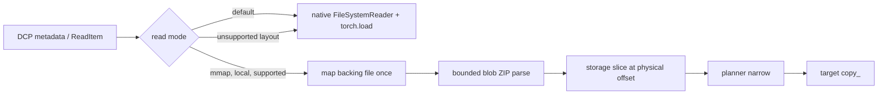
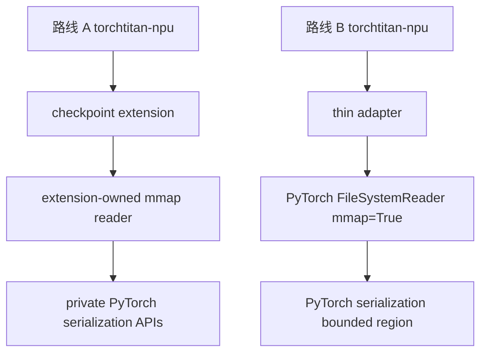

# DCP mmap 双路线实验留档

> 状态：代码整理完成，**本轮未运行测试、训练、NPU、性能实验或 profiler**。下文性能数字均为旧实验的历史记录，不能解释为本分支复测结果。

## 仓库矩阵

| 路线 | 托管 | 仓库 | 分支 | 固定基线 |
|---|---|---|---|---|
| A：仅 torchtitan-npu 扩展 | GitHub | `AWWWOLF/torchtitan-npu-dcp-mmap-extension` | `exp/dcp-mmap-extension-only` | GitCode `cann/torchtitan-npu@5307125a76f9c0c0b9a6fbc33c18cf2de854740e` |
| A：仅 torchtitan-npu 扩展 | GitCode | `ZHANGJIAOGOU/torchtitan-npu-dcp-mmap-extension` | 同上 | 同上 |
| B：PyTorch 原生能力 | GitHub | `AWWWOLF/pytorch-dcp-mmap` | `exp/dcp-mmap-upstream` | `pytorch/pytorch@880a5f4f7b005b364a09e3acc658a8450ce4233a` |
| B：PyTorch 原生能力 | GitCode | `ZHANGJIAOGOU/pytorch-dcp-mmap` | 同上 | 同上 |
| B：torchtitan-npu 薄适配 | GitHub | `AWWWOLF/torchtitan-npu-dcp-mmap-upstream` | `exp/dcp-mmap-upstream-adapter` | GitCode `cann/torchtitan-npu@5307125a76f9c0c0b9a6fbc33c18cf2de854740e` |
| B：torchtitan-npu 薄适配 | GitCode | `ZHANGJIAOGOU/torchtitan-npu-dcp-mmap-upstream` | 同上 | 同上 |

GitHub 的 `torchtitan-npu/torchtitan-npu` 镜像在整理时位于 `dc3e27c34bc23ef61b130e4e703b115a9c2fa1fe`，与 GitCode 官方仓最新提交不同。为包含已合并的 GitCode !688 并让两托管平台内容一致，两个 torchtitan-npu 实验仓统一固定在 GitCode 基线 `5307125...`。

## 代码来源与边界

代码由此前本地 `dcp_experimental_read_modes` 工作区中已经实现、验证过的 mmap 思路整理而来；本次没有从历史分支搬入 `offset_read`、`pread`、预取、`WILLNEED`、profiler 或训练脚本。

GitCode [cann/torchtitan-npu!688](https://gitcode.com/cann/torchtitan-npu/pulls/688) 已完整审阅。实现遵守其扩展架构：永久 TorchTitan 集成位于 `torchtitan_npu/extensions/torchtitan/`，沿用唯一 checkpoint monkey-patch owner，不在 component wiring 层新增 patch，不复制整份上游组件，并将私有 API 集中在单个边界模块。所有 inline review thread 在读取时均为 resolved；自动 CI 通知不带 thread resolved 字段。

本实验仅增加 `default` 与 `mmap` 两种模式。`default` 是默认值，行为委托原实现；`mmap` 必须显式开启。远端/HF checkpoint 继续走原生路径。

## 路线 A：扩展独立实现

变更文件：

- `torchtitan_npu/extensions/torchtitan/components/dcp_mmap_reader.py`：本地 DCP mmap reader；所有 PyTorch 私有 ZIP/serialization API 集中于此。
- `torchtitan_npu/extensions/torchtitan/components/checkpoint.py`：typed config、合法值检查和 reader 选择。
- `DCP_MMAP_EXPERIMENT.md`：本说明。

核心提交：

- `4ab5a7c41f8ffeb459f40140e2e3f38e2720b19f`：reader。
- `970a9bf76101d82a6ffd1980ff797c26582af99a`：配置与接线。

启用方式：

```python
CheckpointManager.Config(
    extensions=CheckpointExtensions(dcp_read_mode="mmap"),
)
```

reader 对每个本地 backing file 只建立一次 `UntypedStorage.from_file` 映射；用 DCP blob 的物理 offset/length 建立 storage slice，并沿用 planner 的 `narrow` 与目标 `copy_`。映射长度只代表虚拟映射范围，不代表物理读取量。它记录 mapped file、mmap 命中、回退原因及映射虚拟字节数，但不声称这些是磁盘读取字节。

安全策略：metadata 物理范围越界、ZIP header/record offset 不一致等错误直接失败；不支持但仍合法的布局（非 ZIP、压缩/加密、跨端序、无 header offset 等）按 item 回退原生 `torch.load`。stream transform、BYTE_IO 和非本地路径不强行 mmap。

## 路线 B：PyTorch 原生实现与薄适配

PyTorch 变更文件：

- `torch/serialization.py`：增加从已映射 storage 安全加载 bounded ZIP region 的私有 helper。
- `torch/distributed/checkpoint/filesystem.py`：`FileSystemReader(..., mmap=False)`；显式开启后按 backing file 复用映射，不支持的 blob 回退原生路径。

PyTorch 提交：

- `686498862d`：bounded ZIP/storage 支持（完整 SHA 以分支 Git 日志为准）。
- `a5e8f1d2b036ded1688e5c3cfae5b5e3247528ba`：DCP reader mmap 参数与接线。

下游 torchtitan-npu 仅修改：

- `torchtitan_npu/extensions/torchtitan/components/checkpoint.py`。

适配提交为 `590419204877bd21abf6335f7c6d36577664f698`。适配层只提供 `dcp_read_mode` 并调用：

```python
reader = torch.distributed.checkpoint.FileSystemReader(
    checkpoint_id,
    mmap=True,
)
```

下游没有 ZIP 解析、PyTorch 私有序列化调用、`UntypedStorage` 或 mmap 细节。若配套 PyTorch 未安装，显式 mmap 会给出版本依赖错误；默认模式不受影响。

## 数据路径





## 两路线比较

| 维度 | A：扩展独立 | B：PyTorch 原生 |
|---|---|---|
| 上游 PyTorch 修改 | 无 | 有，两处 |
| torchtitan-npu 修改 | reader + 配置接线 | 仅配置接线 |
| 私有 API 风险 | 下游集中承担 | PyTorch 内部承担 |
| 可移植性 | 易于独立试验，受 PyTorch 私有 API 漂移影响 | 需要安装配套 PyTorch，其他 DCP 使用者可复用 |
| 默认行为 | 原生，mmap opt-in | 原生，mmap opt-in |
| fallback | 合法但不支持的 item 回退 | 合法但不支持的 item 回退 |
| 本轮验证 | 未运行 | 未运行 |

## 历史结果（不是本轮复测）

以下来自此前 2×Ascend 910B3、220 次 timing 的本地正式报告。它们用于保留实验背景，不能证明本次整理后的分支性能或正确性。

| 读取比例 | 冷读 native 中位数 (s) | 冷读 mmap 中位数 (s) | 时间下降 | native read_bytes | mmap read_bytes | 物理 I/O 变化 |
|---:|---:|---:|---:|---:|---:|---:|
| 10% | 0.073 | 0.031 | 58% | 138.4 MiB | 40.1 MiB | 约 -70% |
| 25% | 0.075 | 0.042 | 44% | 138.4 MiB | 80.0 MiB | 约 -39% |
| 50% | 0.077 | 0.060 | 22% | 138.4 MiB | 151.0 MiB | 约 +9% |
| 75% | 0.079 | 0.065 | 17% | 276.9 MiB | 234.9 MiB | 约 -15% |
| 100% | 0.081 | 0.070 | 14% | 276.9 MiB | 302.0 MiB | 约 +9% |

历史 warm-cache 样本的 `read_bytes=0`，mmap timing 下降约 34%–54%。另一个 DeepSeek 多 blob 完整恢复历史样本中，mmap 约慢 11%。这些差异说明收益依赖请求稀疏度、cache 状态与 blob 布局，不能由 mmap 本身推导固定加速。

## 限制与验证状态

- 本轮按要求只做代码和 Git 检查；未执行 import、编译、lint、单元测试、训练、NPU、benchmark 或 profiler。
- 未验证本次固定基线上的功能正确性、性能、NPU 兼容性或多 rank 恢复。
- A 依赖 PyTorch 私有 serialization API，升级 PyTorch 时必须重新审计。
- B 是实验性 PyTorch API，尚未提交 upstream，也不承诺接口稳定。
- mmap page fault 触发的实际 I/O 由内核决定；映射字节数不是实际读取字节数。
- 没有实现预取、`pread` 或 offset reader，也没有把历史 profiler/测试脚本打包进仓库。
- 与上游讨论相关的公开跟踪项包括 [pytorch/pytorch#199419](https://github.com/pytorch/pytorch/issues/199419)。

## 本轮允许的复核命令

本轮只使用以下 Git 类检查，不代表测试：

```bash
git status --short
git diff --check
git diff --stat
git log --oneline --decorate -n 10
git remote -v
git ls-remote <remote>
```
